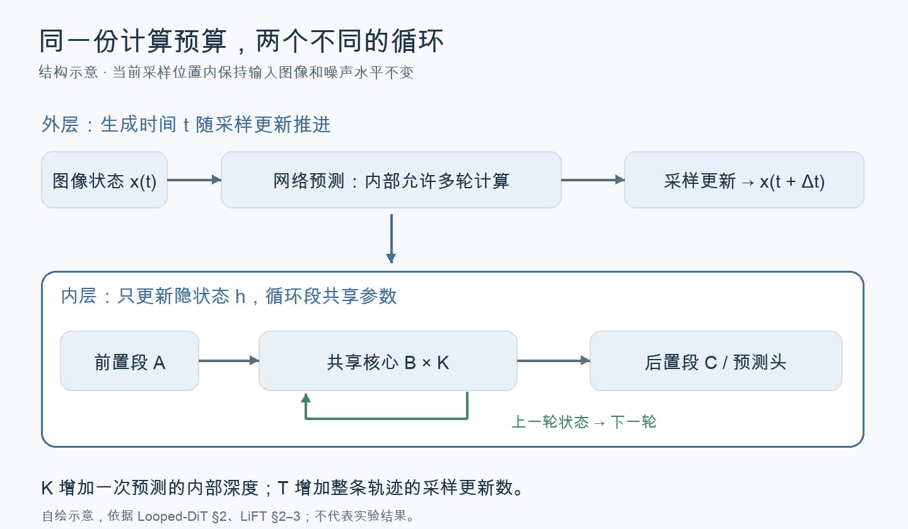
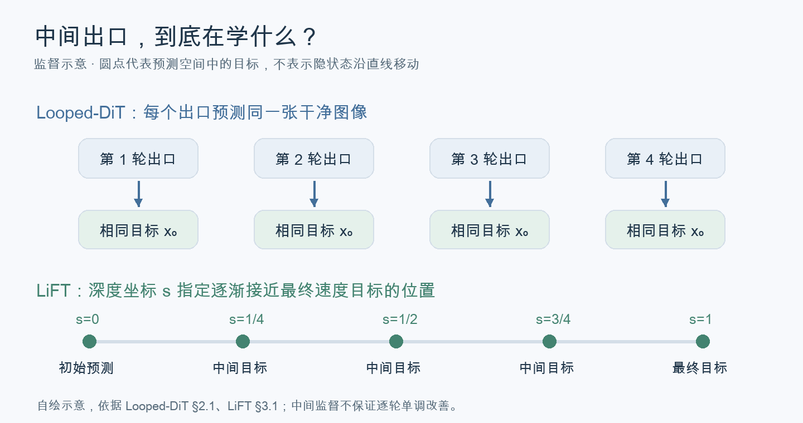
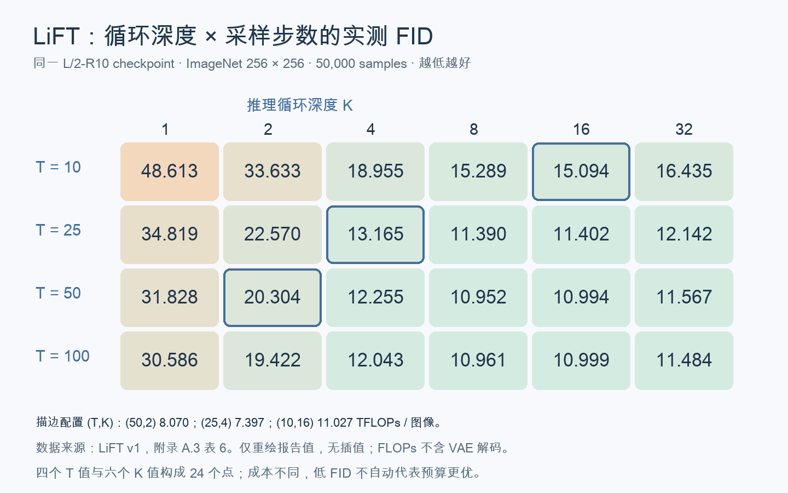
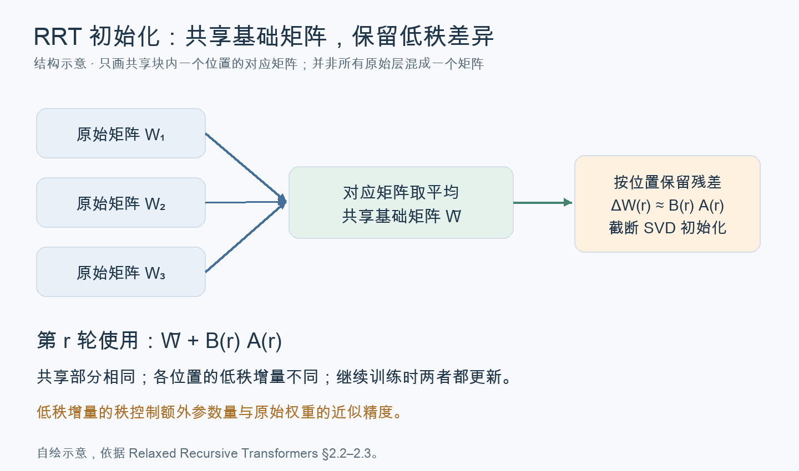

这次阅读是从一个疑问开始的：Diffusion 已经在反复去噪了，为什么还要把 Transformer 放进循环里？同样多花一点 compute，增加内部计算深度，和增加去噪步数，到底差在哪？

顺着这个问题，材料逐渐分成三类：研究循环生成的工作、研究预训练模型如何转换成循环结构的工作，以及研究层和时间相关性的工作。它们常用相近的词，回答的问题却不一样。这篇笔记保留这条检索和辨析的过程，不把所有结果合成一个“循环越多越好”的结论。

> 范围：整理于 2026 年 10 月 21 日（Asia/Shanghai）。核心机制按 Looped-DiT v1、LiFT v1 与 RRT v3 核对；会议信息截至 10 月 20 日。下文数字均来自论文或作者材料，未在本地复现实验。

## 先分清：深度、时间和步数不是一回事

读这些论文时，最容易混在一起的是四个变量。

| 记号 | 在本文中的含义 | 改变的是什么 |
| --- | --- | --- |
| $l$ | 一次网络调用中的层位置 | 用到哪一层的计算或表示 |
| $t$ | 噪声水平或生成时间 | 当前位于生成轨迹的哪个位置 |
| $T$ | 整条轨迹的采样步数 | 用多少次采样更新完成生成 |
| $K$ | 共享核心的循环次数 | 一次预测内部计算多深 |

这里的记号统一用于说明，原论文可能采用其他字母。尤其不能把“某一层在不同 $t$ 下的重要性”直接理解为“增加 $K$ 可以替代增加 $T$”。[LiFT §2–3](https://arxiv.org/html/2610.05538v1#S2)明确分开了计算深度与生成时间；其 flow matching（流匹配，即学习从噪声分布到数据分布的速度场）背景来自 [Flow Matching for Generative Modeling](https://arxiv.org/abs/2210.02747)。

*图 1：依据 Looped-DiT 与 LiFT 自绘的结构示意，不代表实验结果。内层循环结束后，外层采样器才推进。*

可以把两种计算理解成：一方面，用更多步数跟随预测出的生成方向；另一方面，在当前位置花更多计算形成这次预测。这是理解上的区分，不是误差能够完全分离的定理。模型预测和采样轨迹会相互影响。

计算预算也不能只数“前向次数”。FLOPs 表示浮点运算次数，1 TFLOP 为 $10^{12}$ 次浮点运算。共享核心每循环一次的成本，通常小于重新执行整个模型。LiFT 将每张图的推理成本写成 $C_{\mathrm{infer}}=T\,C_{\mathrm{forward}}(K)$；比较不同架构时，还要说明是否计入解码器、引导和路由开销，不能把 FLOPs 降低直接当成延迟等比例降低。

## Looped-DiT：先让重复计算变得有用

[Looped-DiT](https://arxiv.org/html/2609.40305v1)把 MiniT2I 的像素空间多模态 Transformer 分成前置段 $A$、共享段 $B$ 和后置段 $C$。这里的 MMDiT 指分别处理图像、文本并通过联合注意力交互的骨干；本文依据 Looped-DiT §2 的使用方式讨论它。

$$
h^{(0)}=A(h_{\mathrm{input}}),\qquad
h^{(r)}=B(h^{(r-1)}),\qquad
\hat{x}_0=C(h^{(K)}).
$$

下一轮接收图像和文本的隐状态。默认分块为 $6/5/6$，中间五块执行四轮：存储 17 组块参数，执行 32 次块计算。单纯重复并不可靠，作者因此引入两项设计。[见 §2、图 2](https://arxiv.org/html/2609.40305v1#S2)。

深监督（Deep Supervision）让每一轮状态都能经过共享的 $C$ 预测干净图像，再对同一目标计算损失。它缩短早期状态获得监督的路径，也要求中间出口保持可用；**这并不保证每轮误差严格下降**。训练需要额外解码中间状态，推理则只读最终出口。[见 §2.1](https://arxiv.org/html/2609.40305v1#S2.SS1)。

自调节注意力（Self-Modulating Attention）处理反复更新的强度。可学习门控按 token 和 attention head 缩放输出；另一种 XSA（Exclusive Self Attention，独占自注意力）用投影去掉输出沿该 token 自身 value 方向的分量。XSA 不等于简单删除注意力矩阵对角线，也不直接跳过计算。[见 §2.2 及附录 A.3](https://arxiv.org/html/2609.40305v1#S2.SS2)。

这两项设计分别约束“中间状态能不能预测”和“后续更新会不会过度改写”。位置探针与更新范数提供了支持，但作者也承认，关于潜在视觉推理的证据主要是行为和表示层面的。[见 §3.3、局限部分](https://arxiv.org/html/2609.40305v1#S3.SS3)。

图 6 正面比较了循环和去噪步数：给单轮对照增加采样步数，匹配四轮模型的推理 FLOPs，还用了同一个 checkpoint 作为对照，控制训练历史。报告的设置支持循环更划算，但组合有限，尚不足以描述整个预算空间。于是检索继续转向 LiFT。

## LiFT：把循环深度和采样步数放进同一张图

[LiFT](https://arxiv.org/html/2610.05538v1)为不同循环指定不同中间目标。令 $u_0$ 为初始速度预测，$u^\star$ 为训练目标，$s\in[0,1]$ 为计算深度坐标，它构造：

$$
\bar{u}_s=(1-s)\,\operatorname{sg}(u_0)+s\,u^\star.
$$

$\operatorname{sg}$ 表示停止这条目标分支的梯度。训练随机采样中间深度坐标，最终坐标固定为 1；推理改用均匀坐标，让不同循环预算都到达同一个端点。[见 §3.1、算法 1–2](https://arxiv.org/html/2610.05538v1#S3.SS1)。

*图 2：自绘监督示意。LiFT 的直线位于预测空间；不表示隐状态沿直线运动，也不保证学到的核心就是一个数值积分器。*

更有价值的是 §4.4 与附录 A.3 的联合扫描。同一 L/2-R10 checkpoint，改变 $T$ 和 $K_{\mathrm{inf}}$，比较质量与计算量。FID（Fréchet Inception Distance，用特征分布距离评估生成质量，越低越好）采用论文的 50,000 张图评估协议；该指标最初见 [Heusel 等，2017](https://arxiv.org/abs/1706.08500)。

*图 3：按 LiFT v1 附录 A.3、表 6 的 24 个网格点重绘，未插值。颜色表示 FID，低值更好。每个格子的成本不同，不能只沿某一行判断哪种分配更划算。*

| 同一 checkpoint 的配置 | TFLOPs / 图像 | FID ↓ |
| --- | ---: | ---: |
| 50 步 × 2 轮 | 8.070 | 20.304 |
| 25 步 × 4 轮 | 7.397 | 13.165 |
| 10 步 × 16 轮 | 11.027 | 15.094 |

第二行比第一行更便宜、质量更好；第三行又比第二行更贵、更差。这里能支持的是**两种计算需要共同分配**，不是循环总比步数重要。更小的 B/2 模型没有呈现同样优势，不能忽略容量条件。[见 §4.3–4.4](https://arxiv.org/html/2610.05538v1#S4.SS4)。

<iframe src="/demos/diffusion-depth-step/allocation.html" title="LiFT 实测循环深度与采样步数预算比较" width="100%" height="720" loading="lazy" style="border:1px solid #dbe3ea;border-radius:14px;"></iframe>

[单独打开数据交互图](/demos/diffusion-depth-step/allocation.html)。调整预算后，图中只标出所展示 24 个实测点里的最优值；它不预测未测配置，也不代表连续空间的最优解。表 6 还报告了 50 步下 3 轮、5 轮的两个配置，未纳入此规则网格。

### 这些结果用了多大的训练？

LiFT 主实验是 ImageNet-1k 的类别条件生成，分辨率 256×256；SD-VAE 将图像转成 $4\times32\times32$ latent，以 $2\times2$ patch 得到 256 个 token。作者训练自己的 dense 和 LiFT 对照，使用相同数据流程。[见 §4.1、附录 D](https://arxiv.org/html/2610.05538v1#A4)。

| 代表模型 | 参数量 | 核心块数 | 训练循环数 |
| --- | ---: | ---: | ---: |
| LiFT-B/2-R4 | 88.58M | 4 | 2 |
| LiFT-L/2-R10 | 270.24M | 10 | 2 |
| LiFT-XL/2-R12 | 389.58M | 12 | 2 |
| Dense DiT-L/2 | 457.83M | — | — |

主配置使用 4 个前置块、没有 Transformer coda。每个模型训练 500k updates、全局 batch 256，使用 4 张 H100。1.28 亿是累计图像呈现次数，包含重复读取，并非独立图片数。原文未明确交代预训练权重初始化，也未验证“普通 DiT 微调后即可得到同样效果”。[见表 15–16、附录 D.5](https://arxiv.org/html/2610.05538v1#A4)。

### 为什么还要保留反例？

Wenhao Chai 的 [LoopDiT 实验博客](https://wenhaochai.com/exps/loopdit.html)在小型 DiT-B/4、MeanFlow 目标下发现，小预算时更多采样步数更划算。MeanFlow 是预测有限时间区间平均速度的生成目标，原始方法见 [Mean Flows for One-step Generative Modeling](https://arxiv.org/abs/2505.13447)。

博客的预算比较使用 80-epoch checkpoint，作者列出了训练预算和规模的限制。它不能否定 LiFT，却足以阻止我们把“共享权重可以多算”直接推成“这些计算一定有效”。初始化、训练目标、模型容量与评估任务都可能改变结果。

## 现成模型能改吗：RRT 的共享权重从哪里来

检索到 [Relaxed Recursive Transformers（RRT）](https://arxiv.org/html/2410.20672)后，问题具体了许多：原始层并不需要全部丢掉，可以先把它们转换为共享结构，再继续训练。

论文比较了选取前部层、间隔取层、平均对应层权重等初始化。放松共享约束的版本以共享矩阵加上位置独立的低秩增量表示原始层：

$$
W_{j,r}\approx \bar{W}_j+B_{j,r}A_{j,r},\qquad
\bar{W}_j=\frac1K\sum_r W^{\mathrm{original}}_{j,r}.
$$

$j$ 表示共享块内的位置，$r$ 表示原来的逻辑深度。低秩增量按残差的截断 SVD（奇异值分解）初始化；LoRA 即用低秩矩阵乘积表达权重增量，其原始方法见 [Hu 等，2021](https://arxiv.org/abs/2106.09685)。

*图 4：依据 RRT §2.2–2.3 自绘。共享的是基础矩阵，各循环位置的 LoRA 不共享；继续训练时两者都更新。图中只画一个对应矩阵组，实际转换涉及多个层与矩阵。*

RRT 的关键贡献是用层独立的低秩增量放松严格共享，在额外参数量与原模型的恢复能力之间折中。论文讨论了增量的秩对原始权重近似精度的影响；其转换后的继续训练会更新共享权重与低秩增量，而非只训练 adapter。[见 RRT §2.3、§3.5](https://arxiv.org/html/2410.20672v3#S2.SS3)。

“微调”也要看量级。RRT 的初始化比较用了 15B tokens 的 uptraining（转换后的继续训练）；不能把它理解成几百条任务数据的轻量适配。[见 §2.2、§3.4](https://arxiv.org/html/2410.20672#S2.SS2)。

后续检索还找到 LoopUS、Closing the Loop 和小模型 adapter 转换实验，见文末清单。它们证明预训练模型改造成循环结构已有直接研究，但这些语言模型结果不能直接替代 DiT 证据。

## Layer × timestep：已有论文究竟测了什么

筛选截图中的相关工作时，判断标准从“名字有没有 depth、step”变成了“它到底测量或控制了什么”。下面的公式采用统一记号，便于横向阅读；概括记号不冒充原论文定义。

| 工作与原文定位 | 表征方式 | 可以支持的结论与边界 |
| --- | --- | --- |
| [DAR §3、图 2–3](https://arxiv.org/html/2605.20708#S3) | 激活 RMS、梯度 RMS、相邻块余弦相似度；历史 residual source 的门控梯度与学习权重 | 不同深度、时间偏好不同信息来源；聚合来源不等于跳过计算 |
| [Timestep-Aware Block Masking §3](https://arxiv.org/html/2603.19939#S3) | 二维执行掩码 $m_{t,b}$；相邻时间输出的相对变化与教师特征误差 | 衡量计算能否被缓存替代；依赖缓存历史，不是层的绝对重要性 |
| [MD-DiT 官方海报](https://adaptive-foundation-models.org/posters/MD-DiT_AFM_2024_Poster.pdf) | 搜索各时间、各块的执行／跳过／缓存方案 | 优化既定采样过程中的计算路径；全文访问受限，搜索细节尚未完整核对 |
| [TinyFusion §3](https://arxiv.org/html/2412.01199#S3) | 固定层掩码与权重适应联合优化 | 看剪枝后能否恢复，而非只看即时误差；不是随时间变化的深度调度 |
| [DyDiT §4.5、图 5–6](https://arxiv.org/html/2410.03456#S4.SS5) | 时间相关 head/channel 激活图、空间 token 计算量 | 主要改变 width 与 token 计算；不能由此推出循环次数的最优安排 |
| [DiffCR §3、图 2、5](https://arxiv.org/html/2412.16822#S3) | layer × timestep 区域的 token 压缩率，以及依赖输入的 token 选择 | 已有样本相关计算路由；压缩配额和具体 token 选择是两个层次 |
| [Diffusion Hyperfeatures §3.2、图 5](https://arxiv.org/html/2305.14334#S3.SS2) | 特征聚合权重 $w_{l,t}$，用语义匹配任务监督 | 衡量下游任务的特征效用；主体是 U-Net，不是 DiT |
| [DIFT §4.2、附录 D](https://arxiv.org/html/2306.03881#S4.SS2) | 搜索提取层与噪声水平，以对应任务的准确率评价 | 同样是 U-Net 特征选择；有用的特征不等于必须执行的生成计算 |

RMS 指均方根；这里的具体测量定义见 DAR §3。DIFT 与 Hyperfeatures 使用的 PCK 是正确关键点比例，定义见各自评估章节。它们关注“信息在哪”，缓存与剪枝工作关注“哪些计算可以省”，LiFT 的联合网格则直接评价“预算怎样分配”。这几种证据不能相互替代。

## 从检索清单到贡献判断

这轮阅读最有帮助的变化，是不再按一个共同关键词给论文归类。具体需要核对：改的是权重存储、层执行、token 数量、表示聚合，还是采样过程？对照是否保持 checkpoint、训练 FLOPs 和数据一致？更高分究竟来自循环、额外训练，还是其他新增组件？

FlashLoop 是一个提醒：它从循环冗余出发，优化推理计算与 KV 缓存，但不能据此说明图像生成中的循环已经更经济。Looped-DiT 的同 checkpoint 对照比单纯跨模型排名更接近因果问题；LiFT 的联合网格又比只固定一个轴更完整。即使如此，FID 也不是所有语义能力的代名词，已有实验不能被扩写成通用规律。

会议信息也需要按原始记录核对。MD-DiT 是 NeurIPS workshop，R-MDMs 已核实的是 ICML workshop；“在 ICML 上展示”不能简写成“ICML 主会”。DAR 已注明 NeurIPS 2026 Poster，但截至核对日应写成已接收，而不是会议已经结束。预印本仍然有阅读价值，只是证据状态要写清楚。

目前能稳妥保留的判断是：内部计算深度和外部采样步数确实是两种可调资源，但它们的收益取决于模型如何训练、共享核心有多大，以及评价什么任务。层与时间相关的重要性分析解释了计算不均匀的现象；要评价预算分配，仍需回到等成本的最终生成结果。

## 本次讨论的论文与阅读范围

下表按问题分类。“机制／实验”表示读到了相应原文部分，不代表逐式复现；“摘要／官方说明”不包含未核实的细节。简称在正文已链接到对应原文。会议状态仅列截至 2026-10-20 能确认的记录；未确认不代表未投稿。

### 循环生成与推理计算

| 论文／材料 | 问题、方法与本次关系 | 阅读与发表状态 |
| --- | --- | --- |
| [FlashLoop: Fast and Memory-Efficient Looped Transformers via Lazy Updates](https://arxiv.org/abs/2609.29812) | 以稀疏更新和残差量化减少循环冗余；提醒参数节省不等于推理节省 | 机制／实验；arXiv 2026 |
| [Looped Diffusion Transformer](https://arxiv.org/abs/2609.40305) | 用中间监督和注意力调节稳定文生图循环；提供等推理成本对照 | v1 机制／实验；arXiv 2026 |
| [LiFT: Loop Flow Transformers — Loop in Depth, Flow in Time](https://arxiv.org/abs/2610.05538) | 深度坐标与轨迹目标支持循环外推；联合比较循环和积分步数 | v1 机制／实验、附录；arXiv 2026 |
| [ELT: Elastic Looped Transformers for Visual Generation](https://arxiv.org/abs/2604.09168) | 用循环内自蒸馏支持不同出口；与直接深监督形成对照 | v3 方法部分；[ECCV 2026](https://link.springer.com/book/10.1007/978-3-032-37324-3) |
| [Looped Diffusion Language Models](https://arxiv.org/abs/2605.26106) | 循环前中部层、调整推理循环数；提供扩散语言模型视角 | 摘要／部分实验；arXiv 2026 |
| [Recursive Scaling in Masked Diffusion Models](https://arxiv.org/abs/2606.18022) | 在结构化生成中比较递归与去噪预算；显示任务依赖性 | 预算实验；[ICML 2026 FoGen workshop，non-archival](https://openreview.net/pdf/b3cd08f7079ff7ce5f390c1261ad460247c4a93f.pdf) |
| [LoopDiT: Loop Transformers for Diffusion Models](https://wenhaochai.com/exps/loopdit.html) | 小型模型的循环与步数负面结果；校正单向解释 | 作者实验博客，非会议论文 |
| [Scaling Inference Time Compute for Diffusion Models](https://openaccess.thecvf.com/content/CVPR2025/html/Ma_Scaling_Inference_Time_Compute_for_Diffusion_Models_CVPR_2025_paper.html) | 将预算用于噪声搜索与验证；说明增加计算不只增加步数 | 摘要／相关实验；CVPR 2025 |
| [Scaling Properties of Diffusion Models for Perceptual Tasks](https://openaccess.thecvf.com/content/CVPR2025/html/Ravishankar_Scaling_Properties_of_Diffusion_Models_For_Perceptual_Tasks_CVPR_2025_paper.html) | 比较步数、集成和时间日程；补充感知任务的分配视角 | 摘要／相关实验；CVPR 2025 |

### 预训练模型转换

| 论文 | 问题、方法与本次关系 | 阅读与发表状态 |
| --- | --- | --- |
| [Relaxed Recursive Transformers: Effective Parameter Sharing with Layer-wise LoRA](https://arxiv.org/abs/2410.20672) | 利用预训练权重、平均与低秩残差初始化，再继续训练恢复能力 | 方法／初始化实验；[ICLR 2025](https://deepmind.google/research/publications/122290/) |
| [LoopUS: Recasting Pretrained LLMs into Looped Latent Refinement Models](https://arxiv.org/abs/2605.11011) | 中间层递归、选择性门控和随机深监督；直接面向模型后训练转换 | 方法／官方仓库；arXiv 2026 |
| [Closing the Loop: Practical Training Recipes for Looped Language Models](https://arxiv.org/abs/2610.00673) | 输入混合与退出损失的简化转换配方；含相同数据继续训练对照 | 原文摘要，未精读预算；arXiv 2026 |
| [Retrofitting Recurrent Depth into a Pretrained Language Model: Installation, Extrapolation, Transfer, and Retention at Two Parameter Budgets](https://arxiv.org/abs/2608.11233) | 比较 adapter 与模块训练的递归安装及能力保留 | 原文摘要，受控任务证据；arXiv 2026 |

### 层、时间与表示

| 论文 | 问题、方法与本次关系 | 阅读与发表状态 |
| --- | --- | --- |
| [Rethinking Cross-Layer Information Routing in Diffusion Transformers](https://arxiv.org/abs/2605.20708) | 诊断 residual 信息流并学习时间相关聚合；区分读信息与省计算 | 诊断／方法；作者注明 NeurIPS 2026 Poster 已接收 |
| [Timestep-Aware Block Masking for Efficient Diffusion Model Inference](https://arxiv.org/abs/2603.19939) | 冻结模型学习时间相关执行掩码，以缓存替代部分计算 | 方法；arXiv 2026，未确认会议 |
| [MD-DiT: Step-aware Mixture-of-Depths for Efficient Diffusion Transformers](https://openreview.net/pdf?id=1jWhiakK7N) | 无梯度搜索 block skipping/cache 方案；优化各时刻执行成本 | 论文可检索文本／官方海报；[NeurIPS 2024 AFM workshop](https://adaptive-foundation-models.org/) |
| [TinyFusion: Diffusion Transformers Learned Shallow](https://openaccess.thecvf.com/content/CVPR2025/html/Fang_TinyFusion_Diffusion_Transformers_Learned_Shallow_CVPR_2025_paper.html) | 联合学习剪层与权重适应；以可恢复性衡量静态深度选择 | 方法；CVPR 2025 |
| [Dynamic Diffusion Transformer](https://proceedings.iclr.cc/paper_files/paper/2025/hash/a44a70acd5d0abc1a252ada9719dd06d-Abstract-Conference.html) | 动态宽度与空间 token 路由；展示噪声阶段的计算差异 | 方法／可视化；ICLR 2025 |
| [Layer- and Timestep-Adaptive Differentiable Token Compression Ratios for Efficient Diffusion Transformers](https://research.adobe.com/publication/layer-and-timestep-adaptive-differentiable-token-compression-ratios-for-efficient-diffusion-transformers/) | 学习层与时间区域的压缩率；细粒度计算选择的直接相关工作 | 方法／可视化；CVPR 2025 |
| [Diffusion Hyperfeatures: Searching Through Time and Space for Semantic Correspondence](https://papers.neurips.cc/paper_files/paper/2023/hash/942032b61720a3fd64897efe46237c81-Abstract-Conference.html) | 学习跨层、跨时间特征聚合；刻画下游任务效用 | 方法／可视化；NeurIPS 2023 |
| [Emergent Correspondence from Image Diffusion](https://proceedings.neurips.cc/paper_files/paper/2023/hash/0503f5dce343a1d06d16ba103dd52db1-Abstract-Conference.html) | 选择 U-Net 层和噪声水平提取匹配特征；区分表示和生成贡献 | 方法／超参数分析；NeurIPS 2023 |

### 概念联系与延伸材料

| 论文 | 问题、方法与本次关系 | 阅读与发表状态 |
| --- | --- | --- |
| [Efficient Parallel Samplers for Recurrent-Depth Models and Their Connection to Diffusion Language Models](https://proceedings.mlr.press/v306/geiping26a.html) | 用 diffusion-forcing 风格采样并行推进 recurrent-depth 模型；联系两种迭代范式 | 摘要／官方论文集；ICML 2026 |
| [Coevolutionary Continuous Discrete Diffusion: Make Your Diffusion Language Model a Latent Reasoner](https://proceedings.mlr.press/v306/zhou26bd.html) | 联合连续表示与离散 token 去噪；讨论表达与可训练性的差异 | 摘要／官方说明；ICML 2026 |
| [One Step Forward and K Steps Back: Better Reasoning with Denoising Recursion Models](https://arxiv.org/abs/2604.18839) | 用多步递归恢复噪声破坏的输入；连接去噪训练与递归推理 | 摘要；[ICLR 2026 Latent & Implicit Thinking workshop](https://openreview.net/pdf?id=o1KnUEh8Nj) 已确认 |
| [DiffusionBlocks: Block-wise Neural Network Training via Diffusion Interpretation](https://proceedings.iclr.cc/paper_files/paper/2026/hash/994c9bc68bc30954f6e5995864f1d92d-Abstract-Conference.html) | 将块解释为去噪变换以支持分块训练；目标与推理循环分配不同 | 摘要／作者博客；ICLR 2026 |
| [D-Loop: Looped Diffusion Drafting for Speculative Decoding](https://arxiv.org/abs/2610.06011) | 循环复用 drafter，通过前缀条件修订后缀；属于解码应用 | 原文摘要；arXiv 2026 |

SpiralFormer、RecurrentGPT、RecursiveVLM、Training-Free Looped Transformers、LoopSpec 曾在检索中出现，未进入本次机制比较。它们分别涉及多分辨率递归、递归调制、多模态递归、冻结模型推理包装和自推测解码；以上仅为摘要层面的定位，不补写未核实的实验结论。原始入口依次为 [SpiralFormer](https://arxiv.org/abs/2602.11698)、[RecurrentGPT](https://arxiv.org/abs/2608.15062)、[RecursiveVLM](https://arxiv.org/abs/2602.09080)、[Training-Free Looped Transformers](https://arxiv.org/abs/2605.23872)、[LoopSpec](https://arxiv.org/abs/2609.17184)。

另有 [ODEₜ(ODEₗ)](https://arxiv.org/abs/2506.21714) 与 [Scalable Adaptive Computation for Iterative Generation](https://proceedings.mlr.press/v202/jabri23a.html) 被检索为时间／网络计算的背景线索，未在这轮讨论中精读，不据标题推断其具体实验结论。
